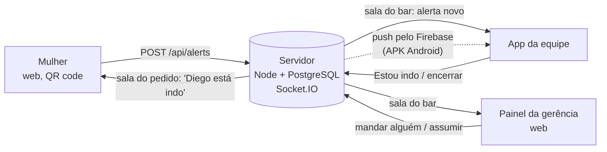

# Mariana

> Pedido de ajuda discreto em bar e casa noturna. A mulher lê o QR code do local e pede ajuda pelo navegador, sem login e sem instalar nada. O celular da equipe toca na hora.

Projeto da **Global Solution CitizenTech** (FIAP). Antes se chamava "Não é Não na Mão" (renomeado em 16/11/2026); o endereço e o nome do repositório ainda levam o nome antigo.

| | |
| --- | --- |
| **Site publicado (web)** | https://naoenao.obrian.me |
| **Testar o app, sem PC** | https://naoenao.obrian.me/testar |
| **Painel da gerência** | https://naoenao.obrian.me/painel |
| **Repositório (público)** | https://github.com/BrianTKK/nao-e-nao-na-mao |
| **Documentos do projeto** | [`docs/ENTREGA.md`](docs/ENTREGA.md) · [`docs/NOTIFICACOES.md`](docs/NOTIFICACOES.md) · [`docs/DEPLOY.md`](docs/DEPLOY.md) |

## Integrantes

⬜ PREENCHER: nomes completos e RMs, em ordem alfabética

## O problema e a solução

Numa casa noturna, pedir ajuda diante de quem está incomodando é difícil. A mulher precisa de um jeito discreto de avisar a equipe, e a equipe precisa saber quem avisou, onde e se alguém já foi.

A Mariana liga três pessoas por um servidor em tempo real:

1. **A mulher** lê o QR code da porta do banheiro ou da mesa, escolhe o que está acontecendo e recebe uma **palavra-código**. Ela não cria conta nem instala nada.
2. **A equipe** (garçom, segurança) recebe o alerta no **app**, toca em "Estou indo", diz a palavra-código a ela e encerra com o desfecho. A mulher vê na própria tela: "Diego, de camisa preta, está indo até você".
3. **A gerência** acompanha tudo no **painel web**: quadro ao vivo, mandar alguém, cadastro da equipe, QR codes para imprimir e o relatório do mês.

O nome lembra Mariana Ferrer, que, segundo o relato dela, foi dopada e estuprada num beach club de Florianópolis em dezembro de 2018. Em novembro de 2020 veio a público o vídeo da audiência em que o advogado de defesa a humilha, e o projeto que virou a [Lei 14.245/2021](https://legis.senado.leg.br/norma/35190605) (Lei Mariana Ferrer) foi apresentado dois dias depois ([Congresso](https://www.congressonacional.leg.br/materias/materias-bicamerais/-/ver/pl-5096-2020), [Câmara](https://www.camara.leg.br/noticias/829960-lei-que-protege-vitimas-de-estupro-em-julgamento-entra-em-vigor/)). A lei protege a dignidade de vítimas e testemunhas no processo. O sistema não usa a imagem dela. A página inicial explica a origem do nome, cita Mariana Ferrer e a Lei 14.245/2021, e o resto da interface usa só "Mariana".

**Quadro legal, em um parágrafo.** A [Lei federal 14.786/2023](https://www.planalto.gov.br/ccivil_03/_ato2023-2026/2023/lei/l14786.htm) cria o protocolo "Não é Não" para casas noturnas, boates, espetáculos musicais em locais fechados e shows, com venda de bebida alcoólica; bares e restaurantes fora desse enquadramento podem adotá-lo e, conforme regulamentação (não localizada), receber o selo. Ela deixa facultativo que o local crie um código próprio para a mulher avisar a equipe (Art. 7). Em São Paulo, a [Lei 17.621/2023](https://www.al.sp.gov.br/repositorio/legislacao/lei/2023/lei-17621-03.02.2023.html) obriga bares, restaurantes e casas noturnas a auxiliar a mulher em risco e admite "outros mecanismos" de comunicação entre ela e o estabelecimento; a [Lei 17.635/2023](https://www.al.sp.gov.br/repositorio/legislacao/lei/2023/compilacao-lei-17635-17.02.2023.html) exige capacitação anual dos funcionários; e o [Decreto 67.856/2023](https://www.al.sp.gov.br/repositorio/legislacao/decreto/2023/decreto-67856-01.08.2023.html) institui o protocolo "Não se Cale", prevê um livro de ocorrências facultativo e coloca as sanções com o Procon-SP. O relatório do mês do painel é uma ferramenta do produto para o local mostrar o que fez numa fiscalização; nenhuma dessas normas pede esse relatório. O Fórum Brasileiro de Segurança Pública registra, na pesquisa Visível e Invisível 2025, que 11,3% das mulheres foram abordadas de forma agressiva durante uma festa no último ano ([infográfico](https://forumseguranca.org.br/wp-content/uploads/2025/03/visiveleinvisivel-2025-infografico.pdf)). A Mariana não substitui a polícia nem a capacitação da equipe; ela encurta o caminho entre o pedido e a presença de alguém.

**ODS.** A solução se liga principalmente ao **ODS 5**, meta 5.2 (eliminar a violência contra mulheres e meninas, inclusive nas esferas públicas), e ao **ODS 11**, meta 11.7 (espaços públicos seguros, inclusivos e acessíveis, em particular para as mulheres). Como apoio, ao **ODS 16**, meta 16.1 (reduzir a violência). Fontes: [ONU Brasil, ODS 5](https://brasil.un.org/pt-br/sdgs/5), [ODS 11](https://brasil.un.org/pt-br/sdgs/11) e [ODS 16](https://brasil.un.org/pt-br/sdgs/16). A ligação com a 11.7 é por analogia: bar é espaço privado de uso público. E a contribuição é local, no estabelecimento; o projeto não mede as metas.

## Quem usa o quê

| Quem | Onde | O que faz |
| --- | --- | --- |
| Mulher no bar | **Web**, pelo QR code (`/q/<código>`) | Pede ajuda, recebe a palavra-código, acompanha a resposta, cancela, troca a tela pelo cardápio ou pelo Wi-Fi do próprio local (se ele cadastrou), liga para o 190 ou o 180 |
| Equipe (segurança, garçom) | **App** (React Native, Expo) | Recebe o alerta com alarme, toca em "Estou indo", diz a palavra-código e encerra com o desfecho |
| Gerência | **Web**, no painel (`/painel`) | Quadro ao vivo, mandar alguém ou assumir, cadastro da equipe e dos locais, QR codes para imprimir, histórico, tempos de resposta e relatório do mês |

Cada plataforma tem um motivo para existir. O app é de quem anda pelo salão e precisa ser acordado; a web é da mulher, que não pode ser obrigada a instalar nada, e da gerência, que coordena e presta contas.

## Como a integração funciona



1. **O pedido.** A página do QR chama `POST /api/alerts` com o código do local e o tipo de pedido. O servidor grava no banco e devolve um **token aleatório** que só aquela página conhece; o banco guarda apenas o hash.
2. **O aviso.** O servidor avisa a sala do bar por **WebSocket (Socket.IO)**. O app da equipe toca e o quadro da gerência atualiza. No APK Android próprio, o servidor também manda **push pelo Firebase (FCM)**, para o alerta chegar com o app minimizado ou fechado, com repetição até alguém ver. Isso foi validado contra o Firebase de verdade (`validate_only`) e ainda não foi testado num celular real.
3. **A resposta.** Quem toca em "Estou indo" no app chama a API. O servidor grava o horário e avisa duas salas: a do bar (app e quadro) e a do pedido, que é a da página da mulher.
4. **Sem sinal.** Se o WebSocket da página dela cair, ela consulta o servidor a cada 3 segundos; sem nenhuma conexão, a página mostra um cartão para levar ao balcão. No app, o que a equipe faz sem sinal (o "Visto", automático ao abrir o alerta, o "Estou indo" e o "Encerrar") fica guardado no aparelho e são enviados quando a conexão volta, sem duplicar no servidor (cada ação tem um id). O estado aparece com texto e ícone de Wi-Fi riscado ("Sem sinal: vai enviar quando voltar" e "A caminho, ainda não enviado"). Se outra pessoa assumiu ou encerrou o alerta enquanto o aparelho estava sem sinal, o toque guardado é descartado e o app avisa, sem sobrescrever; o aviso fica até a pessoa tocar em "Entendi". Toque guardado há mais de 12 horas também é descartado, com aviso. Quem é da equipe comum não encerra o alerta que outra pessoa assumiu. A gerência encerra esse alerta pelo painel: o app esconde "Encerrar…" de quem não é o responsável quando o alerta está a caminho com outra pessoa, e isso vale também para a gerência. Toque guardado sem sinal nunca passa por cima de quem assumiu, nem o da gerência. Limite conhecido, de propósito: abrir a página do QR já sem conexão não funciona, porque a página dela não instala nada no celular nem guarda nada além do próprio pedido.

**Quem vê o quê.** A página da mulher só lê o próprio pedido, pelo token. A equipe e a gerência entram com login (senha em bcrypt, token que vence) e só enxergam o próprio bar. As rotas da gerência exigem o papel `manager`.

## Como rodar o app (para quem avalia)

Não precisa de PC nem de servidor local: o servidor já está publicado, e o app abre pelo Expo Go ou pelo APK.

### Opção 1: Expo Go, com a URL pública

1. Instale o **Expo Go** (SDK 58) no celular.
2. Abra **https://naoenao.obrian.me/testar** em outra tela e leia o QR code com o Expo Go. No próprio celular, use o botão "abrir no Expo Go".
3. No app, toque em **"Preencher com a conta de teste do Diego"** e depois em "Entrar". A conta é do bar fictício de demonstração, que volta ao estado inicial todo dia.

Observação: no Expo Go do Android o alarme só chega com o app aberto ou em segundo plano recente. O push com o app fechado exige o APK (opção 2).

### Opção 2: APK Android (app próprio, com push)

1. No celular Android, abra **https://naoenao.obrian.me/testar** e toque em "Baixar o app para Android" (o link direto está na mesma página). O link público entrega o `versionCode` 4, com a F3, e instala por cima das versões anteriores.
2. Abra o arquivo e permita "instalar apps desconhecidos" para o navegador, quando o Android pedir.
3. Entre com o botão de conta de teste e aceite as notificações. Para o alarme passar pelo "Não perturbe", permita isso nos ajustes do canal "Alertas (alarme)".

O APK não está nas lojas e só tem Android; no iPhone, use o Expo Go. A geração do APK está em [`docs/NOTIFICACOES.md`](docs/NOTIFICACOES.md).

### Ver o laço completo, em duas telas

1. No computador, abra **https://naoenao.obrian.me/painel** e use o botão da conta de teste da gerência.
2. No celular, entre no app com a conta de teste da equipe.
3. Em outra aba, abra a página do QR do bar de demonstração (a página `/testar` e o painel, em "QR codes", mostram os códigos), peça ajuda e veja o alerta chegar ao app e ao quadro. Toque em "Estou indo" e veja a página da mulher mudar.

## Rodar tudo no PC

Requisitos: Node 20 ou mais novo (testado no 24) e, para o celular, o Expo Go (SDK 58). Não precisa de Docker: sem `DATABASE_URL`, o servidor usa o mesmo PostgreSQL embutido (PGlite).

```bash
npm install
cp server/.env.example server/.env   # já vem com SEED_DEMO=1 (bar de demonstração)
```

Em três terminais, na raiz:

```bash
npm run server   # servidor e banco embutido em http://localhost:8080
npm run web      # web em http://localhost:5173 (repassa /api e /socket.io ao servidor)
npm run mobile   # app (Expo): leia o QR code com o Expo Go
```

- **App com o servidor publicado**: sem o arquivo `mobile/.env`, o app aponta para `https://naoenao.obrian.me` por padrão.
- **App com o servidor no PC**: copie `mobile/.env.example` para `mobile/.env`. O modelo vem com `EXPO_PUBLIC_DATA_SOURCE=mock` (dados simulados, que ignoram o servidor): troque por `EXPO_PUBLIC_DATA_SOURCE=api` e ponha `EXPO_PUBLIC_API_URL=http://<IP-do-PC-na-rede>:8080`. O celular precisa estar no mesmo Wi-Fi.
- **Sem servidor** (para desenhar telas): `VITE_DATA_SOURCE=mock` na web ou `EXPO_PUBLIC_DATA_SOURCE=mock` no app.
- **Bar de demonstração**: com `SEED_DEMO=1`, a página do QR fica em `http://localhost:5173/q/ESQBF7K2` (outros códigos em `db/seed.sql`). A página `/testar` preenche a conta de teste com um toque; as contas só agem nesse bar e não valem para nada real.

Outros scripts: `npm run typecheck` (TypeScript em todas as pastas), `npm run build -w server` e `npm run build -w web`.

## Testes

```bash
npm test                     # shared (Vitest) + funções do banco + servidor + deploy
npm run typecheck            # TypeScript nos quatro pacotes
npm run test:reflow -w web   # reflow (WCAG 1.4.10)
npm run test:a11y -w web     # acessibilidade da web (axe, teclado, texto a 200%, cartão sem rede)
npm run test:offline -w mobile  # fila de toques sem sinal no app
npm run test:a11y -w mobile  # acessibilidade do app, pelo Expo web
```

Estado em 18/11/2026: a F3 está commitada na `main` deste repositório, que é público. ⬜ CONFERIR antes da entrega: O servidor e o site com a F3 foram publicados em 18/11/2026. O app novo (`versionCode` 4) é publicado em seguida.

- **`npm test`**: 167 testes automáticos (68 em shared, 13 do banco, 79 do servidor, 7 do deploy), mais o `npm run typecheck`. Cobrem os tokens visuais e o contraste, as funções do banco (token só como hash e com validade, limites, ordem das etapas, bar não age sobre outro bar), a API (login, token falso ou vencido, validação de entrada, limite por IP, tempo real entre salas, push, gerência, idempotência da fila sem sinal) e o script de limpeza do deploy.
- **`test:reflow`** (Playwright, Chromium): 90 verificações, sem rolagem lateral a 195, 260, 320, 390 e 1440 px, em 18 telas. 195 px é um celular de 390 px com zoom de 200%. Se faltar o navegador, rode antes `npx playwright install chromium`.
- **`test:a11y` na web**: axe (WCAG 2.1 A e AA) em 18 telas e 3 tamanhos (390x844, 820x1180, 1440x900), mais o menu aberto e o cartão do balcão (60 telas/tamanhos); rodada só com teclado na página dela e no painel, a 390 e 1440 px (604 passos); texto a 200% nas 18 telas a 390 px e espaçamento de texto (WCAG 1.4.12); cartão do balcão com a rede desligada, contra o servidor de verdade (32 conferências).
- **`test:offline` no app**: 28 verificações da fila sem sinal, com o app aberto no navegador (Expo web) contra o servidor de verdade e a rede cortada pelo Playwright.
- **`test:a11y` no app**: 463 verificações pelo Expo web, em 13 telas/estados e 3 larguras (390, 260 e 195 px, que simulam fonte grande): axe, nome acessível de todo controle, regiões vivas, alvos de 48 px, texto não cortado, palavra-código inteira e "Reduzir movimento".
- **Revisão**: a F3 passou por um painel adversarial sobre o diff commitado, com segundo leitor para cada achado. Foram duas rodadas, e os 24 achados confirmados foram corrigidos com teste (`a18433d` e `29f9dea`).
- **Não testado**: leitor de tela de verdade (TalkBack, VoiceOver, NVDA; só nomes, papéis e regiões vivas foram conferidos, no código e no navegador); celular real (o APK `versionCode` 4 não foi instalado em aparelho); fonte grande do sistema Android (simulada por largura de tela); Firefox e Safari; impressão A4.

O estado de cada requisito está em [`docs/ENTREGA.md`](docs/ENTREGA.md), separando o que foi testado do que não foi.

## Estrutura

```
shared/    tokens visuais, tipos, textos e a camada de dados (servidor ou simulada)
server/    Node (Express 5): API em /api, WebSocket em /socket.io e a web compilada, na mesma origem
db/        migrações SQL (tabelas e funções), seed do bar de demonstração e testes
web/       Vite + React: página do QR code e painel da gerência
mobile/    Expo SDK 58 + Expo Router: app da equipe
deploy/    Nginx, cron e modelos de configuração (ver docs/DEPLOY.md)
docs/      ENTREGA.md, NOTIFICACOES.md e DEPLOY.md
```

- **Onde ficam as regras**: o controle de acesso fica na API; o que precisa ser atômico (limite de pedidos, ordem dos estados, horário de cada etapa) fica em funções do banco.
- **Camada de dados trocável**: as telas só conhecem as interfaces de `shared/src/data/ports.ts`. A `api.ts` fala com o servidor e a `mock.ts` simula tudo.
- **Por que React na web**: o app já é React Native. Com React nos dois lados, tipos, textos, regras (`domain.ts`) e camada de dados são o mesmo código.

## Tecnologias

- **App**: React Native 0.88, Expo SDK 58, Expo Router, Reanimated, `expo-notifications`; APK Android próprio com push pelo Firebase (FCM).
- **Web**: Vite, React 19, React Router, CSS próprio a partir dos tokens.
- **Servidor**: Node, Express 5, Socket.IO, PostgreSQL 17 (PGlite no PC), validação com zod, login com bcrypt e JWT.
- **Compartilhado**: TypeScript em tudo, tokens visuais e textos num pacote só (`@nenm/shared`).
- **Publicação**: Docker Compose e Nginx em servidor próprio; o Expo Go público e o APK saem do mesmo domínio (ver `docs/DEPLOY.md`).

## Design, motion e acessibilidade

- **Visual "Comanda"**: verde-garrafa escuro com latão para o alerta e sálvia para a ação calma. O tema escuro é o padrão porque o bar é à meia-luz e uma tela clara no banheiro chama atenção. Os tokens de `shared/src/tokens.ts` valem para a web e o app, e os contrastes são testados.
- **Motion com função**: o pedido novo pulsa até alguém ver; o botão dá retorno ao toque; o cartão "acende" a cada troca de estado no painel; o detalhe do alerta no app mostra a mudança de estado com três trechos que enchem, a linha do estado entrando subindo e um toque háptico. Tudo respeita "Reduzir movimento" (no sistema e numa chave nos ajustes do app).
- **Acessibilidade**: estados sempre com texto e ícone, nunca só cor; área de toque de pelo menos 48 px no app; nomes acessíveis para leitor de tela (conferidos no código e no navegador, não com um leitor de verdade); HTML semântico, link para pular ao conteúdo e foco visível na web; texto em `rem` que acompanha o zoom; reflow até 195 px sem rolagem lateral; linguagem simples.
- **Discrição**: a página da mulher pode se disfarçar de cardápio do próprio local ou de tela de Wi-Fi, que o gerente cadastra no painel; sem nenhum dos dois, fica sem disfarce.
- **Segurança**: senhas em bcrypt, consultas parametrizadas, entrada validada, limite por IP, cabeçalhos do helmet, CSP e CORS fechado, contêiner sem root. A palavra-código nunca vai na notificação, porque aparece na tela bloqueada e é o que prova a ela que a pessoa é da equipe.

O detalhe, item por item, está em [`docs/ENTREGA.md`](docs/ENTREGA.md); o alarme e o push em [`docs/NOTIFICACOES.md`](docs/NOTIFICACOES.md); a publicação em [`docs/DEPLOY.md`](docs/DEPLOY.md).

## Limites conhecidos

- O push no iPhone não está feito (exige conta paga da Apple); no iOS, o app roda pelo Expo Go.
- O link público do APK Android entrega o de `versionCode` 4, com a F3, desde 18/11/2026. Ele ainda não foi instalado em celular. O que foi testado em celular de verdade e o que não foi está descrito em [`docs/NOTIFICACOES.md`](docs/NOTIFICACOES.md).
- Não há teste com usuárias reais nem pesquisa de campo registrada neste repositório.
